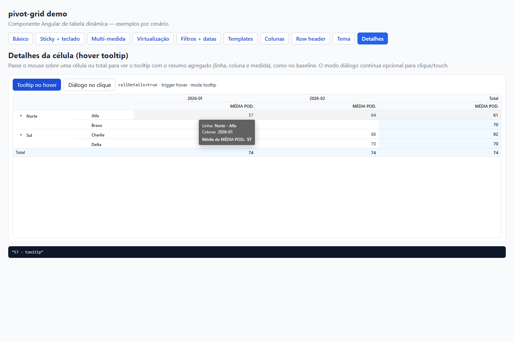

# Detalhes da célula (hover tooltip + diálogo opcional)

Na 2.4.0 o padrão mudou de **clique/diálogo** para **hover/tooltip**, em
paridade com o baseline Syncfusion 20. O diálogo continua disponível
opcionalmente para clique/touch.

## Baseline observado (somente leitura)

O baseline foi inspecionado em `http://localhost/packreturn-green/`
(Gerenciamento → Giro por CDP, ano 2026), via Chrome DevTools Protocol:

| Aspecto | Comportamento |
|---|---|
| Gatilho | **hover** (não clique) |
| Conteúdo | `Row:` caminho `" - "`, `Column:` caminho, `Avg of <medida>:` valor |
| Registros | **não exibe** registros, somente o resumo |
| Atraso | ~20 ms (praticamente imediato) |
| Posição | **junto ao cursor** (+12/+14); `max-width: 350px`; largura ~160–172 px |
| Aparência | fundo cinza `#616161`, texto branco, 12–14 px |
| Totais | mesmo formato; subtotal de coluna mostra o caminho da coluna |
| Tree | tooltip apenas nas células de valor; o cabeçalho de linha não tem tooltip |
| Fechamento | ao sair da célula |
| Teclado/touch | foco/teclado não abre no baseline; sem tooltip por toque |

No pivot-grid, o conteúdo essencial é replicado e adicionamos abertura por
**foco de teclado**, `aria-describedby`, `role="tooltip"` e fechamento com
`Esc`.

## API

```ts
cellDetails?: boolean;                       // default false
cellDetailsTrigger?: 'hover' | 'click';      // default 'hover'
cellDetailsMode?: 'tooltip' | 'dialog';      // default 'tooltip'
detailsColumns?: PivotField[] | string[];   // usado no diálogo/template
detailsTemplate?: TemplateRef<PivotCellDetailsContext>;
```

```html
<!-- tooltip no hover (default) -->
<pg-pivot-grid
  [data]="rows"
  [config]="config"
  [cellDetails]="true">
</pg-pivot-grid>

<!-- diálogo opcional para clique/touch -->
<pg-pivot-grid
  [data]="rows"
  [config]="config"
  [cellDetails]="true"
  cellDetailsMode="dialog"
  cellDetailsTrigger="click">
</pg-pivot-grid>
```

- Delay do tooltip: **150 ms**; fecha ao sair, no scroll e com `Esc`.
- Posiciona **junto ao cursor** (+12/+14) e reposiciona para não sair da
  viewport; no foco por teclado usa a célula como âncora.
- Sem backdrop e sem prender foco no tooltip.
- `detailsTemplate` continua valendo; no modo dialog o contexto inclui
  `records` via `PivotResult.recordsForCell`. No tooltip padrão os registros não
  são copiados (`records: []`), como no baseline.
- `cellDetailsOpen` / `cellDetailsClose` continuam disponíveis.

## Evidência

Hover (tooltip, sem modal):



Diálogo opcional (`cellDetailsMode="dialog"`):


Rotas: [`/detalhes`](https://leonardohessel.github.io/pivot-grid/detalhes) e
[`/detalhes?dialog=1`](https://leonardohessel.github.io/pivot-grid/detalhes?dialog=1).

## Localização (pt-BR)

Os defaults são em inglês (paridade com o baseline: Row/Column/Avg of). Para
pt-BR:

```ts
labels: Partial<PivotLabels> = {
  detailsRow: 'Linha',
  detailsColumn: 'Coluna',
  detailsTitle: 'Detalhes da célula',
  detailsClose: 'Fechar',
  aggregators: { avg: 'Média' },
  measureFormat: '{aggregation} de {caption}',
};
```

Resultado: **Linha:**, **Coluna:** e **Média de MÉDIA POD.:**.

### Baseline × pivot-grid

| Baseline (Syncfusion) | pivot-grid (default) | pivot-grid (pt-BR) |
|---|---|---|
| Row: BELEM - BEL | Row: Norte - Alfa | Linha: Norte - Alfa |
| Column: 2026 - 08/26 | Column: 2026-01 | Coluna: 2026-01 |
| Avg of Média Pod.: 26 | Avg of MÉDIA POD.: 57 | Média de MÉDIA POD.: 57 |
| sem registros | sem registros | sem registros |

