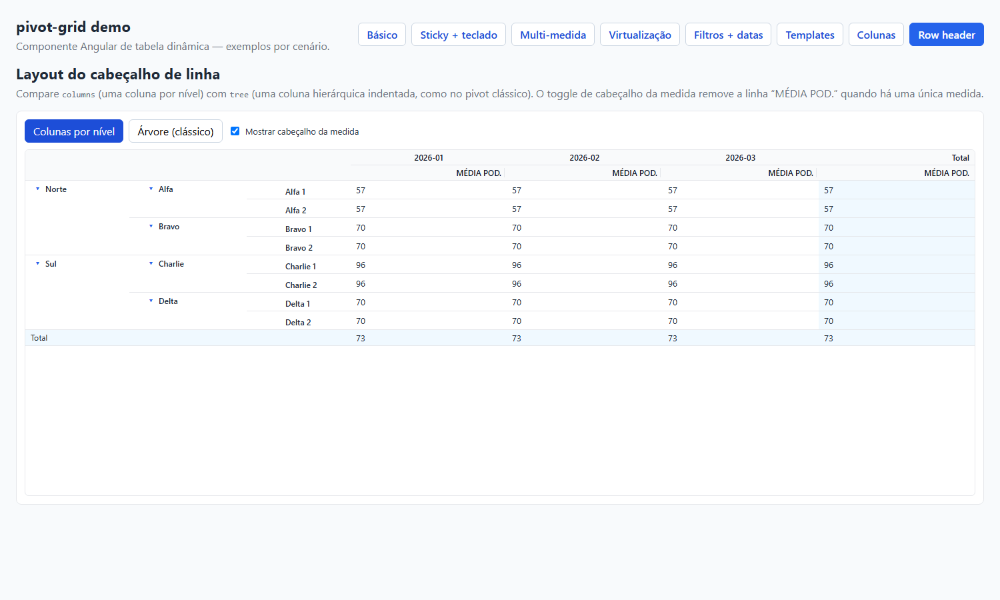
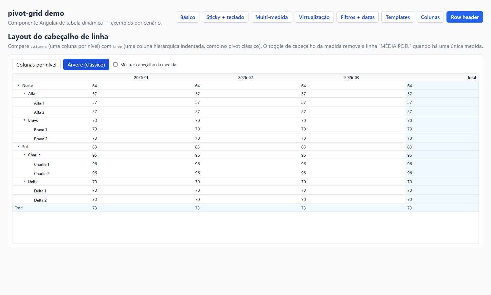

# Layout do cabeçalho de linha (tree × columns)

Adicionado na 2.2.0 (aditivo). O default continua `columns`, sem mudança de
layout para quem não usar a opção.

## API

```ts
rowHeaderLayout?: 'columns' | 'tree'; // default 'columns'
indentSize?: number;                  // default 16 (px)
rowHeaderWidth?: number;              // default 200 (px)
showValueHeader?: boolean;            // default true
```

- **`columns`**: uma coluna por campo de linha (comportamento anterior).
- **`tree`**: uma única coluna hierárquica indentada, com chevrons,
  expandir/colapsar, sticky, virtualização, teclado e templates.
- **`showValueHeader: false`**: com uma medida, remove a linha de cabeçalho da
  medida. Com duas ou mais, a linha é mantida (necessária para distinguir) e um
  diagnóstico `ignored-option` é emitido.

## Config de exemplo

```ts
const config: PivotConfig = {
  rows: [
    { field: 'region', caption: 'Região' },
    { field: 'city', caption: 'CDP Principal' },
    { field: 'cdp', caption: 'CDP' },
  ],
  columns: [{ field: 'month', caption: 'Mês' }],
  values: [{ field: 'amount', caption: 'MÉDIA POD.', aggregator: 'avg' }],
  showRowTotals: true,
  showColumnTotals: true,
  showGrandTotal: true,
  defaultExpandDepth: 'all',
};
```

```html
<pg-pivot-grid
  [data]="rows"
  [config]="config"
  rowHeaderLayout="tree"
  [showValueHeader]="false"
  [indentSize]="18"
  [rowHeaderWidth]="220">
</pg-pivot-grid>
```

## Tema

| Variável | Efeito |
|---|---|
| `--pg-header-font-size` | tipografia dos cabeçalhos |
| `--pg-cell-font-size` | tipografia das células |
| `--pg-row-height` | altura base de células/cabeçalhos |

## Evidência visual

`columns` — uma coluna por nível e a linha da medida repetida:



`tree` + `showValueHeader: false` — uma coluna indentada, sem a linha da medida:



## Demo

Rota: [`/row-header`](https://leonardohessel.github.io/pivot-grid/row-header)
(use os botões para alternar `columns` ↔ `tree` e o checkbox da medida).
