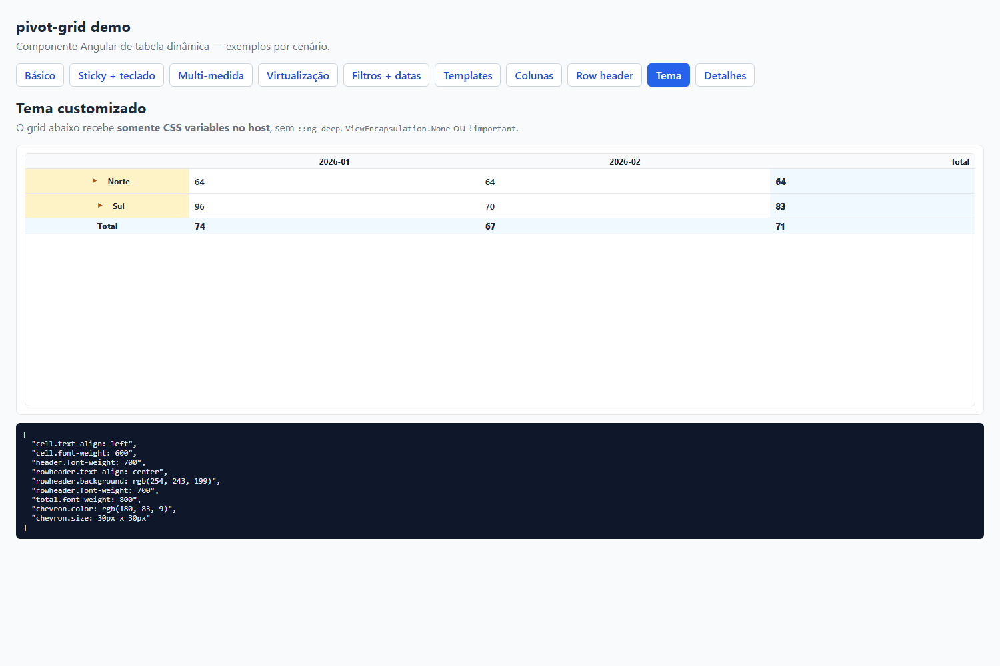

# Tema customizado (CSS variables)

Adicionado na 2.3.0. O consumidor altera o tema apenas com variáveis no host do
componente, **sem** `::ng-deep`, `ViewEncapsulation.None` ou `!important`.

## Exemplo

```html
<pg-pivot-grid
  [data]="rows"
  [config]="config"
  style="
    --pg-cell-align: left;
    --pg-rowheader-align: center;
    --pg-cell-font-weight: 600;
    --pg-header-font-weight: 700;
    --pg-rowheader-font-weight: 700;
    --pg-total-font-weight: 800;
    --pg-chevron-color: #b45309;
    --pg-chevron-size: 20px;
    --pg-rowheader-bg: #fffbeb;
    --pg-group-bg: #fef3c7;
    --pg-rowheader-width: 230px;
  ">
</pg-pivot-grid>
```

## Tokens da 2.3

| Token | Default | Efeito |
|---|---|---|
| `--pg-cell-align` | `right` | alinhamento das células de valor |
| `--pg-rowheader-align` | `left` | alinhamento do cabeçalho de linha |
| `--pg-cell-font-weight` | `400` | peso das células |
| `--pg-header-font-weight` | `600` | peso dos cabeçalhos de coluna |
| `--pg-rowheader-font-weight` | `600` | peso dos rótulos de linha |
| `--pg-total-font-weight` | `600` | peso das células de total |
| `--pg-chevron-color` | `var(--pg-color-muted)` | cor da seta |
| `--pg-chevron-size` | `18px` | glifo e hit area (`size × 1.5`) |
| `--pg-rowheader-bg` | `#fff` | fundo do cabeçalho de linha |
| `--pg-group-bg` | `var(--pg-color-total-bg)` | fundo de linhas de grupo |
| `--pg-rowheader-width` | `200px` | largura no modo tree |

## Alinhamento semântico

```ts
values: [{ field: 'amount', caption: 'Total', align: 'left' }];
```

`PivotValueField.align` sobrescreve o token apenas naquela medida.

## Evidência



Rota: [`/tema`](https://leonardohessel.github.io/pivot-grid/tema)
